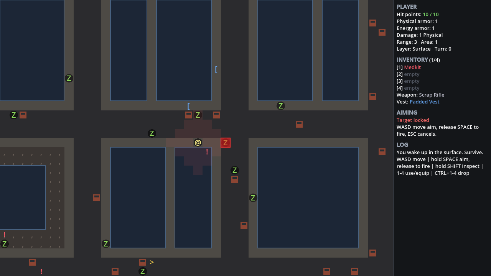

# Post-Apocalyptic Roguelike

A classic turn-based roguelike made with **Godot 4**: a procedurally generated
post-apocalyptic world on a layered 2D grid, seen from above. A ruined city
center with tall buildings, sparse outskirts, a dense forest around it and a
sewer network underneath, all connected by stairs. Every creature, the player
included, acts once per turn.



## How to download and run

### 1. Install Godot 4
1. Download **Godot 4.3 or newer** (Standard version, not .NET) from
   <https://godotengine.org/download>.
2. Extract the zip. Godot doesn't need an installer: just run the `.exe`.

### 2. Download the game
Pick one:
- **Without Git:** on this page, click **Code > Download ZIP** and extract it.
- **With Git:**
  ```bash
  git clone https://github.com/lucasefr/post-apocalyptic-roguelike.git
  ```

### 3. Open and play
1. Open Godot. In the Project Manager, click **Import**.
2. Select the `project.godot` file inside the downloaded folder and click **Import & Edit**.
3. If Godot asks to convert the project to your version, confirm.
4. Press **F5** (or the ▶ button at the top right) to play.

## Controls

| Key | Action |
|---|---|
| **W A S D** / arrows | Move one tile (no diagonals). Stepping on `>` / `<` takes the stairs |
| **Hold SPACE** | Shows weapon range and the attack area in red. WASD moves the aim. **Release** to attack, ESC cancels |
| **Hold SHIFT** | Shows a target icon (starts on the player). WASD moves it. The HUD shows the tile and any enemy on it |
| **1 - 4** | Use a consumable / equip a weapon or vest from that inventory slot |
| **CTRL + 1 - 4** | Drop the item from that slot |
| **R** | New world after dying |

Walk over items to pick them up. Using, equipping, dropping, moving and
attacking each spend your turn.

## Rules

- **Player:** 10 HP, 0 physical / 0 energy armor, 4 inventory slots, plus a weapon slot and a vest slot.
- **Weapons:** damage, damage type, range and area. Range is the maximum (Manhattan)
  distance of the aim. Area 1 hits only the target tile, and each extra point
  grows the hit zone by one tile in every direction. Buildings and trees block line of sight.
- **Armor:** physical / energy armor is subtracted from damage of the same type (minimum 0).
- **Consumables:** instant effect, single use (the Medkit heals 3 HP).
- **Zombies:** if the player is not in range, they step one tile towards the
  player (around obstacles); otherwise they attack.

## Code structure

| File | What |
|---|---|
| `scripts/entities/templates.gd` | Player sheet, item templates and zombie template (**all balance numbers**) |
| `scripts/world/world_generator.gd` | Procedural city center, outskirts, forest, sewers and stairs |
| `scripts/game/game_state.gd` | Turn loop, player actions, spawning, pickups |
| `scripts/game/combat.gd` | Range, area of effect, line of sight |
| `scripts/ai/zombie_ai.gd` | Zombie behavior |
| `scripts/ui/world_renderer.gd`, `scripts/ui/hud.gd` | Map drawing and the HUD column |
| `scripts/core/input_setup.gd` | Key bindings |

## Tests

```bash
godot --headless --path . --script res://tests/run_tests.gd
```
